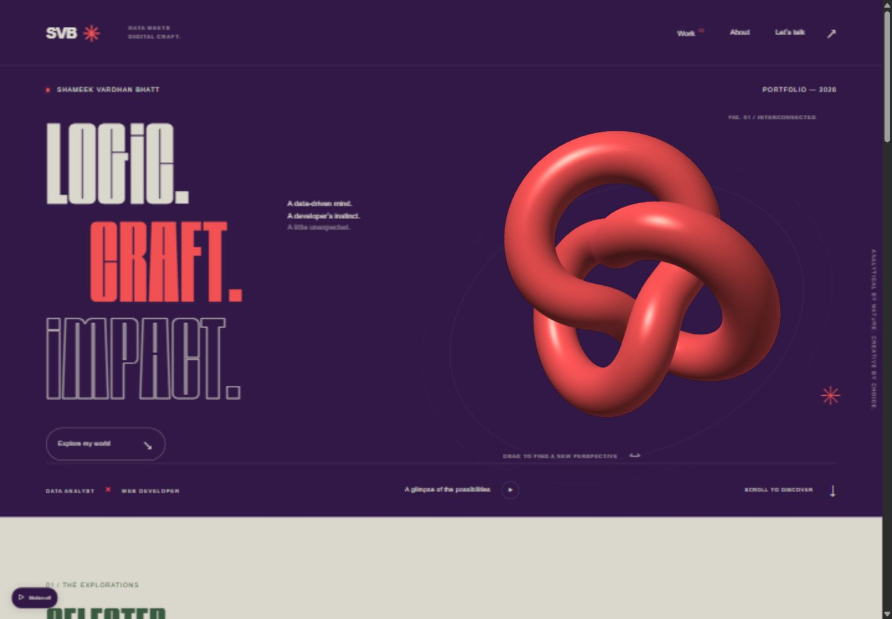

# Personal Projects

A collection of projects by **Shameek Vardhan Bhatt**, Data Analyst & Web Developer based in Bhopal, India.

## Data & Digital — Motion Portfolio

A responsive portfolio built with HTML, CSS, JavaScript, and WebGL. It brings together analytics case studies, interactive demos, and a motion-led design in violet/coral, green/stone, and navy/apricot.



[Explore the portfolio source and documentation](portfolio/README.md) · [Download résumé](portfolio/dist/assets/shameek-vardhan-bhatt-resume.pdf)

### Featured projects

| Project | What to explore |
| --- | --- |
| Ride-Sharing Analytics | A résumé case study covering 100,000+ rows and a five-page Power BI dashboard. |
| IPL Cricket Analytics & Win Prediction | 1,243 matches across 19 seasons, 295,732 delivery events, eight selectable charts, and documented model evaluation. |
| AI Lead Qualification System | Import CSV data, remove duplicates, adjust scoring rules, and export qualified leads. |
| AI Sales Outreach Assistant | Edit personalized drafts, review and approve them, and simulate CRM activity. |
| GTM Revenue Intelligence Dashboard | Filter 8,800 fictional sales opportunities and explore revenue, win rates, pipeline, and sales cycles. |

The automation projects are interactive browser prototypes. AI APIs and external CRM integrations are not connected; email is not sent. See the [data and limitations](portfolio/README.md#data-and-limitations) documentation for details.

## Run locally

With Python 3 installed, run this command from the repository root:

```sh
python -m http.server 4173 --directory portfolio/dist
```

Open **http://localhost:4173**. On Windows, `py` can be used instead of `python`. No npm installation or build step is required.

## Deploy to Vercel

Import `Shameek4/Personal-Projects` with these settings:

| Setting | Value |
| --- | --- |
| Root Directory | `portfolio` |
| Framework Preset | Other |
| Output Directory | `dist` |
| Build Command | Empty / no build step |
| Install Command | Empty / no dependencies |

The [Vercel configuration](portfolio/vercel.json) is included. No environment variables are required for the current static demos. A public deployment URL has not yet been confirmed; localhost is a local preview only.

## Repository layout

```text
portfolio/
  dist/          Website, bundled fonts, data, résumé, and project downloads
  docs/          Website screenshots
  README.md      Project details, validation, sources, and limitations
  vercel.json    Static deployment configuration
```

## Contact

[GitHub](https://github.com/Shameek4) · [LinkedIn](https://www.linkedin.com/in/shameekbhatt) · [Email](mailto:shameekvardhanbhatt2004@gmail.com)
