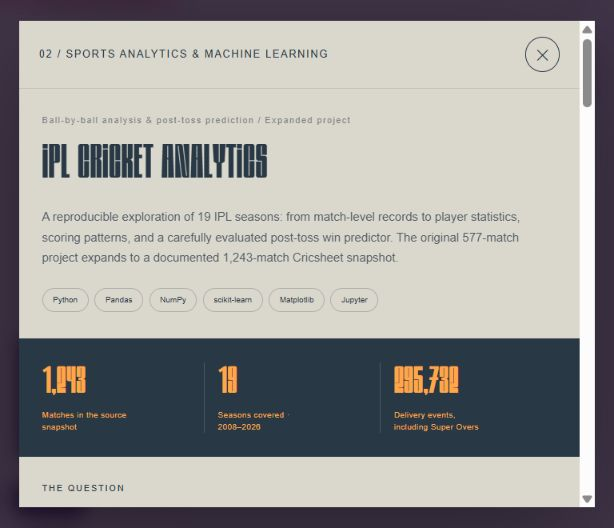
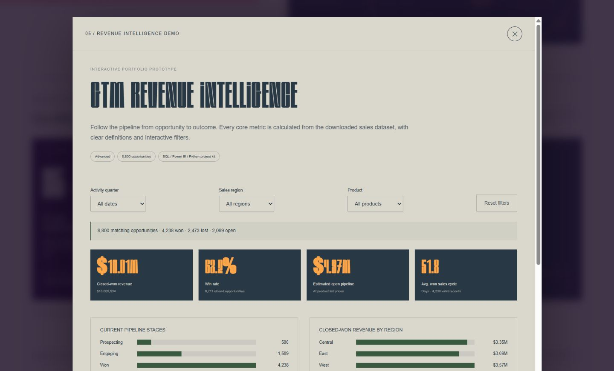

# Data & Digital — Shameek Vardhan Bhatt

A responsive motion portfolio for a Data Analyst & Web Developer. Built with **HTML, CSS, JavaScript, and WebGL**, with no framework dependencies or build step.


## Website experience

- Interactive coral 3D knot with drag and keyboard rotation.
- Introduction sequence, scroll reveals, animation toggle, and reduced-motion support.
- Five project entries with case studies, chart exploration, and interactive demos.
- Profile, skills, education, certifications, contact links, and downloadable résumé.
- Responsive desktop and mobile layouts, keyboard controls, and descriptive image text.

## Projects

### Ride-Sharing Data Analytics

A résumé case study describing analysis of 100,000+ rows across 19 columns and a five-page Power BI dashboard. The portfolio explains the data-cleaning and analysis workflow with a custom illustrative cover. A Power BI `.pbix` file is not included.

### IPL Cricket Analytics & Win Prediction

The original 577-match project expands into a documented Cricsheet snapshot covering **1,243 matches**, **19 seasons (2008–2026)**, and **295,732 delivery events**, including Super Overs. All original matches reconcile by date and teams, with no winner differences.

The case study includes eight selectable charts: first-innings scoring, scoring phases, season coverage, team wins, leading batters, leading bowlers, model predictions, and probability calibration. Each selection updates its image, caption, and download link.



| Saved 2026 holdout result | Random forest | Training-prior baseline |
| --- | --- | --- |
| Accuracy | 45.21% | 42.47% |
| Log loss | 0.6867 | 0.6946 |
| Brier score | 0.2472 | 0.2507 |
| ROC AUC | 0.4800 | 0.5000 |

Training uses 2008–2024, model selection uses 2025 validation log loss, and testing uses 73 decided 2026 matches. These are modest, uncertain results, with an approximate 95% accuracy interval of 34.31%–56.58%. The predictor uses post-toss information; lineups, injuries, weather, and pitch forecasts are not included. Saved holdout metrics are separate from the later all-data refit.

Project files:

- [Portable HTML report](dist/assets/ipl/IPL_Analytics_Report.html) — open through the running website or download to view.
- [Executed notebook](dist/assets/ipl/IPL_Cricket_Analytics.ipynb).
- [Complete project ZIP](dist/assets/ipl/ipl-cricket-analytics-complete.zip), including data, code, models, and documentation.
- [Methodology](dist/assets/ipl/METHODOLOGY.md), [source manifest](dist/assets/ipl/source_manifest.json), and [license notices](dist/assets/ipl/LICENSE.txt).

### AI Lead Qualification System

Import CSV data, deduplicate company names, adjust business scoring criteria, review rule-based company briefs, and export results. The included sample uses fictional company records. LLM-generated research and external workflow integrations are not active.

### AI Sales Outreach Assistant

Create template-based personalized drafts, edit them, request review, approve the exact draft, and export it. Editing resets approval. CRM reply events are simulated locally; the demo does not send email or update an external CRM.

### GTM Revenue Intelligence Dashboard

Explore **8,800 opportunities** with quarter, region, and product filters. The dashboard shows revenue, closed-deal win rate, estimated open pipeline, and average won-deal sales-cycle duration.



The [automation project kit](dist/assets/automation-project-kit.zip) includes source CSVs, Python analysis, SQL, DAX measures, prompts, and an integration plan. It is a reproducible project starter, not a live n8n/HubSpot workflow or a Power BI `.pbix` file.

## Run locally

From this `portfolio` folder, with Python 3 installed:

```sh
python -m http.server 4173 --directory dist
```

Open **http://localhost:4173**. On Windows, use `py` if that is your Python launcher. From the repository root, use `--directory portfolio/dist` instead. Stop the server with `Ctrl+C`.

The static page can also open directly from `dist/index.html`, but localhost or HTTPS is recommended for clipboard functionality. Fonts, chart images, and demo data are bundled locally.

## Deploy to Vercel

Import the GitHub repository and set **Root Directory** to `portfolio`, **Framework Preset** to **Other**, and **Output Directory** to `dist`. Leave the install and build commands empty. The included [vercel.json](vercel.json) supplies the static-project configuration; no environment variables are required.

When deploying this folder by itself, use it as the project root. When using another static host, publish the contents of `dist/`.

No public deployment URL has been confirmed. The local preview address is not a public hosting URL.

## Data and limitations

The automation demos use [Maven Analytics CRM Sales Opportunities](https://mavenanalytics.io/data-playground/crm-sales-opportunities), a public-domain dataset about fictional companies. [Source metadata](dist/assets/DATA-SOURCES.json) documents provenance and field definitions.

Lead-source and campaign attribution are explicitly labeled synthetic because those fields are absent from the source data. Open pipeline is estimated from product list prices. Other dashboard metrics are calculated from source records.

The AI-titled demos use templates and rules in the browser. LLM APIs, n8n, Google Sheets, and HubSpot are not connected. CRM activity lasts only for the current browser session.

IPL data is credited to **Cricsheet / Stephen Rushe**, under [ODC-By 1.0](https://cricsheet.org/licensing/). Derived tables normalize names and calculate statistics, while original notices are retained. The supplied snapshot covers 18 April 2008 through 31 May 2026; coverage may omit unplayed fixtures. No Cricsheet endorsement is implied.

## Color and typography

| Pair | Colors |
| --- | --- |
| Russian violet / Imperial red | `#311847` / `#F15152` |
| Forest green / Stone | `#3A5A40` / `#DAD7CD` |
| Navy / Apricot | `#283845` / `#FFA649` |

CHORUS Black and Bold are bundled, with attribution in [FONT-NOTICES.txt](dist/assets/FONT-NOTICES.txt). Kirgina is not bundled: its free demo is personal-use only, and embedding requires the appropriate license. The secondary-heading stack checks for locally installed Kirgina and falls back to Chorus. A licensed webfont can be supplied to embed Kirgina for all visitors.

## Validation performed

- JavaScript syntax checks passed.
- Desktop (1440 × 1000) and mobile (390 × 844) checks found no horizontal page or IPL-dialog overflow.
- Project workflow switching, IPL chart selection, lead scoring/deduplication, outreach approval and edit reset, simulated replies, revenue filters/reset, and education disclosure were exercised.
- No browser console errors appeared during those checks.
- IPL charts, report, notebook, and complete ZIP returned HTTP 200 with bytes matching the local originals.
- Full-dataset dashboard values matched independent Python/SQL calculations: 4,238 won and 2,473 lost opportunities, $10,005,534 won revenue, 63.150052% win rate, $4,966,215 estimated open pipeline, and 51.781973 average won-cycle days.
- IPL source counts, saved prediction accuracy/log loss, and the source archive checksum were independently checked. Supplied model binaries were not executed or retrained during portfolio integration.

## File guide

```text
dist/
  index.html       Page structure and profile content
  styles.css       Main design and responsive styles
  projects.css     Case-study and demo styles
  app.js           Motion, WebGL, and page interactions
  projects.js      Case studies and IPL chart selection
  labs.js          Interactive automation and revenue demos
  assets/          Fonts, résumé, CRM data, and project downloads
    ipl/           Charts, report, notebook, methodology, and full ZIP
docs/              Screenshots used in this README
vercel.json        Static deployment settings
```

## Contact

**Shameek Vardhan Bhatt** · Bhopal, India  
[Email](mailto:shameekvardhanbhatt2004@gmail.com) · [LinkedIn](https://www.linkedin.com/in/shameekbhatt) · [GitHub](https://github.com/Shameek4)
